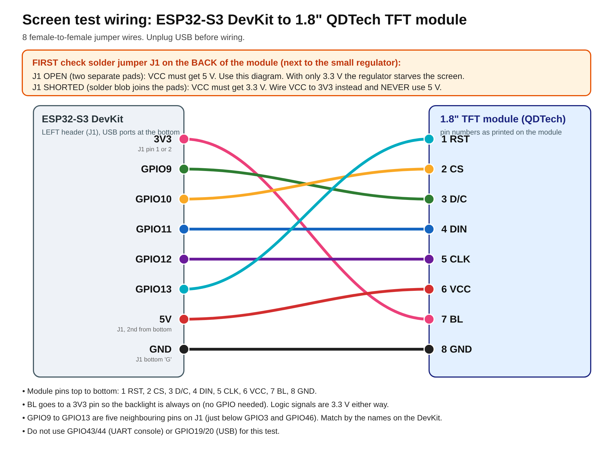

# TFT screen test (ESP32-S3 DevKit wired straight to the 1.8" module)

Purpose: prove the screen itself works, with no expansion board in the way. Nothing else is tested here.

The module is a **QDTech 1.8" 128x160 with a Samsung S6D02A1 controller** (pins printed on the module: 1 RST, 2 CS, 3 D/C, 4 DIN, 5 CLK, 6 VCC, 7 BL, 8 GND).
The driver is a port of [zigwart/Adafruit_QDTech](https://github.com/zigwart/Adafruit_QDTech) (MIT, based on Adafruit's ST7735 library): same init sequence, ESP32 SPI instead of AVR registers. It also lets you try the plain Adafruit ST7735 init for comparison.

## FIRST: check solder jumper J1 on the module's back
The module has a small regulator and a solder jumper **J1** (printed box: `VCC=5V + J1 OPEN`, `VCC=3.3V + J1 SHORT`).
- **J1 open** (two separate pads, the usual state): feed VCC with **5 V**. With only 3.3 V the regulator starves the screen: backlight on, nothing on the display.
- **J1 shorted** (solder joins the pads): feed VCC with **3.3 V** and never 5 V.
Signal pins stay 3.3 V logic either way. Check J1 with a multimeter in continuity mode if you are not sure.

## Wiring: 8 female-to-female jumpers, USB unplugged



| Module pin | Wire to ESP32-S3 DevKit |
|---|---|
| 1 RST | GPIO13 |
| 2 CS | GPIO10 |
| 3 D/C | GPIO9 |
| 4 DIN | GPIO11 |
| 5 CLK | GPIO12 |
| 6 VCC | **5V** if J1 is open (3V3 if J1 is shorted) |
| 7 BL | 3V3 |
| 8 GND | GND |

GPIO9 to GPIO13 sit next to each other on the DevKit's left header (J1), after GPIO3 and GPIO46. Match by the names printed on the DevKit.

## Flash
```bash
cd screen_test
pio run -t upload
pio device monitor -b 115200
```
Use the USB-C port that shows up as the UART bridge (`usbmodem...`, VID 1A86). No pin here uses GPIO43/44, so the serial log stays clean.

## What you should see
The screen fills red, green, blue, white, black (1.2 s each), then draws bars and the words **SCREEN OK**. The serial log prints each step.

Keys in the monitor: `1` QDTech init (default), `2` `3` `4` plain ST7735 init (black, green, red tab), `k` clock demo, `i` invert colours, `h` help.

## Reading the result
| What happens | Meaning |
|---|---|
| Colours and SCREEN OK appear | The screen and wiring are fine. Only the expansion-board wiring remains. |
| Works with `1` but not `2` to `4` | It is the S6D02A1 controller, so use the QDTech driver. |
| Works with `2` but not `1` | It is an ST7735, so use the Adafruit ST7735 driver. |
| Colours wrong (red shows blue) | Controller is right, only colour order differs. Tell us. |
| Backlight only, nothing else, on `1` to `4` | Check VCC first (J1 rule above), then wires 1 to 5 one by one. |
| Nothing lights at all | Check VCC, BL and GND wires, and the 3V3 pins. |
